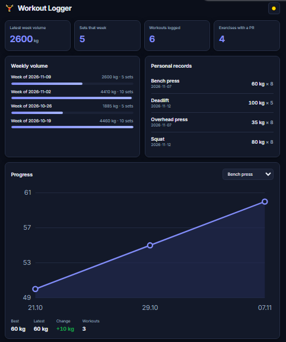
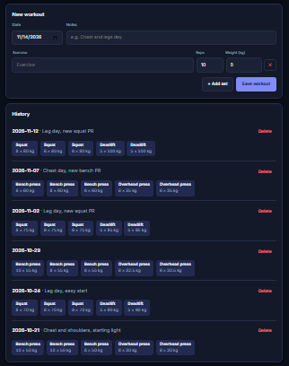
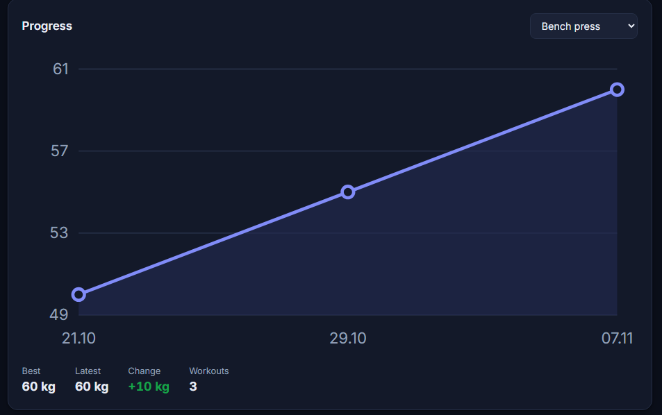
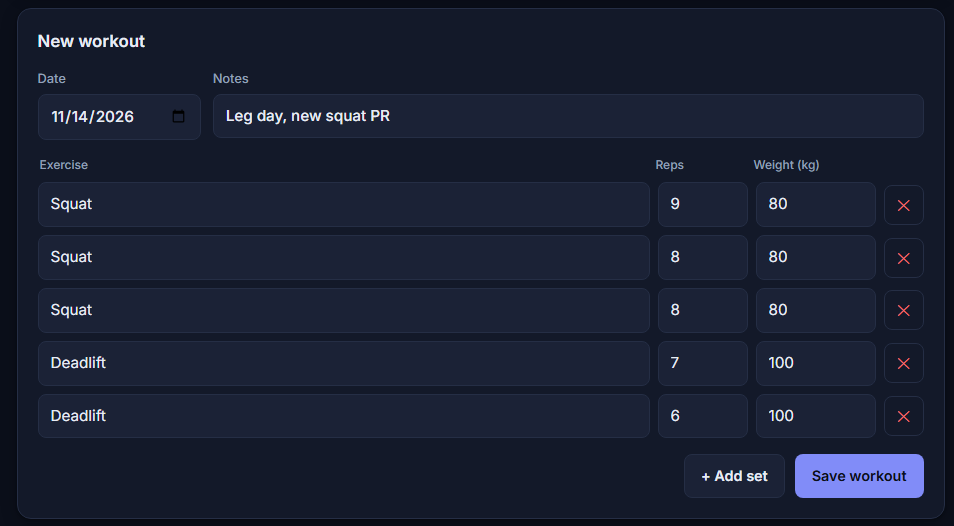
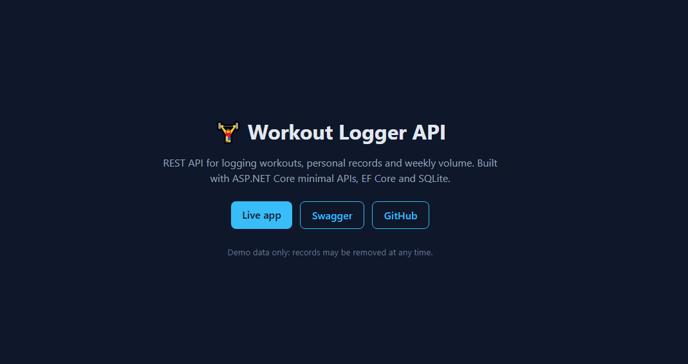
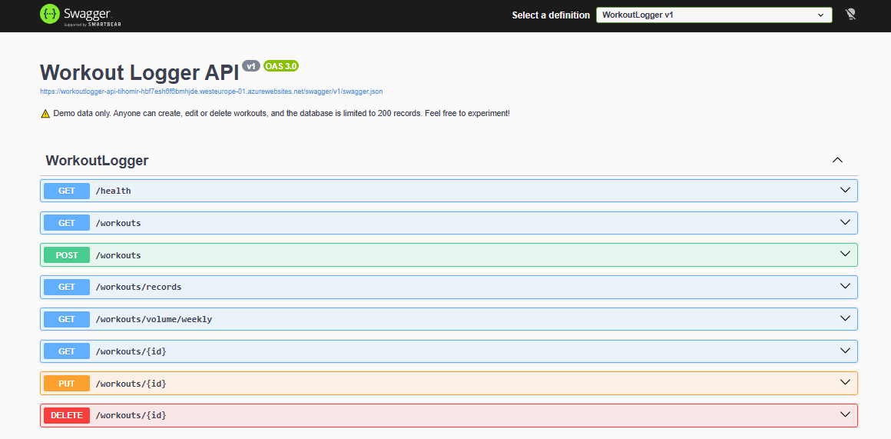

# Workout Logger

A full-stack workout diary. Log workouts as sessions made of sets, see your
personal records, your weekly training volume and your progress per exercise.

| | |
|---|---|
| 🌐 **Live demo** | [blue-field-047855810.4.azurestaticapps.net](https://blue-field-047855810.4.azurestaticapps.net) |
| ⚙️ **API** | [workoutlogger-api-tihomir-...azurewebsites.net](https://workoutlogger-api-tihomir-hbf7esh6f6bmhjde.westeurope-01.azurewebsites.net) |
| 📖 **Swagger UI** | [Open Swagger](https://workoutlogger-api-tihomir-hbf7esh6f6bmhjde.westeurope-01.azurewebsites.net/swagger) |

> Hosted on Azure free tiers: the first request after a period of inactivity
> can be slower. The online instance holds **demo data only**: anyone can
> create, edit or delete workouts, and the database is limited to 200 workouts.

## Screenshots

### Workout diary



### Progress per exercise


### New workout dialog


### API: landing page and Swagger UI



## Features

- Create, view, update and delete workouts (a workout has many sets)
- Progress chart per exercise
- Input validation with clear error messages
- Personal record per exercise (heaviest set)
- Weekly volume (reps x weight, weeks start on Monday)
- Filter the workout list by date range
- Swagger UI for exploring and trying the API, also online
- `/health` endpoint for monitoring and waking up the free tier
- Demo limit of 200 workouts to protect the public database
- Automated API tests (xUnit)
- Deployed to Azure with automatic frontend deployment

## Tech stack

- **Backend:** ASP.NET Core minimal API (.NET 10), Entity Framework Core, SQLite, migrations
- **Frontend:** Angular 20
- **Tests:** xUnit with an in-memory SQLite database
- **Hosting:** Azure Static Web Apps (frontend), Azure App Service (API)
- **CI/CD:** GitHub Actions (frontend)

## Project structure

| Folder | Description |
|---|---|
| `WorkoutLogger` | ASP.NET Core API |
| `WorkoutLogger.Tests` | xUnit API tests |
| `WorkoutLoggerUI` | Angular frontend |
| `docs/screenshots` | Images used in this README |

## Run locally

### API

```bash
cd WorkoutLogger
dotnet run
```

The console shows the address (for example `http://localhost:5194`).
Swagger UI is available at `/swagger`. The SQLite database is created
automatically on the first start.

### Frontend

```bash
cd WorkoutLoggerUI
npm install
ng serve
```

Open `http://localhost:4200`. The API must be running.

### Tests

```bash
dotnet test
```

## API

| Method | Endpoint | Description |
|---|---|---|
| GET | `/` | Landing page with links to the app, Swagger and GitHub |
| GET | `/health` | Health check, returns `ok` |
| GET | `/workouts` | List workouts (optional `?from=` and `?to=`, format `yyyy-MM-dd`) |
| GET | `/workouts/{id}` | Get one workout |
| POST | `/workouts` | Create a workout |
| PUT | `/workouts/{id}` | Replace a workout |
| DELETE | `/workouts/{id}` | Delete a workout |
| GET | `/workouts/records` | Personal records |
| GET | `/workouts/volume/weekly` | Weekly volume |

Example request body:

```json
{
  "notes": "Chest and legs day",
  "sets": [
    { "exercise": "Bench press", "reps": 10, "weightKg": 60 },
    { "exercise": "Squat", "reps": 8, "weightKg": 80 }
  ]
}
```

### Validation

Invalid requests return `400 Bad Request` with the problems listed per field.

| Field | Rule |
|---|---|
| `date` | Optional, cannot be in the future |
| `notes` | Up to 500 characters |
| `sets` | 1 to 50 sets |
| `exercise` | Required, up to 100 characters |
| `reps` | 1 to 1000 |
| `weightKg` | 0 to 1000 (0 is allowed for bodyweight exercises) |

### Demo limit

The database holds at most 200 workouts. When the limit is reached, `POST
/workouts` returns `409 Conflict` until a workout is deleted.

## Deployment

| Part | Azure service | How it is deployed |
|---|---|---|
| Angular frontend | Static Web Apps (Free) | GitHub Actions on every push to `master` |
| .NET API | App Service (Free F1, Windows) | Publish from Visual Studio |
| Database | SQLite file in `D:\home\data` | Created by migrations on startup |

### Configuration (App settings)

| Name | Example value | Purpose |
|---|---|---|
| `AllowedOrigins__0` | `https://blue-field-047855810.4.azurestaticapps.net` | Origin allowed by CORS |
| `ConnectionStrings__Default` | `Data Source=D:\home\data\workouts.db` | SQLite database path |

Locally, the defaults are used: CORS allows `http://localhost:4200` and the
database is `workouts.db` next to the app.

The frontend reads the API address from `apiUrl` in the Angular
`environment.ts` file.

### Limitations of the free tier

- The SQLite file survives restarts and new deployments, but Free F1 gives no
  durability guarantee. Do not store important data.
- The app can start slowly after being idle.

## Roadmap

- Edit a workout from the UI
- Wake up the API from the frontend using `/health`
- Move the database to Azure SQL
